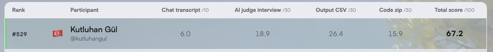
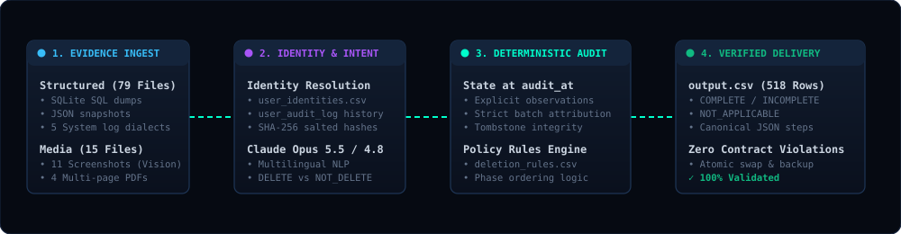

<div align="center">



<br /><br />

[](https://www.hackerrank.com/contests/hackerrank-orchestrate-october26/challenges/ghost-data-still-exists/leaderboard)
[](https://www.hackerrank.com/contests/hackerrank-orchestrate-october26/challenges/ghost-data-still-exists/leaderboard)
[](https://www.hackerrank.com/contests/hackerrank-orchestrate-october26/challenges/ghost-data-still-exists/leaderboard)
[](#-çıktı-sözleşmesi-ve-doğrulama-kuralları)
[-a855f7?style=for-the-badge&labelColor=0d1117)](#-ölçülen-performans-ve-değerlendirme-metrikleri)
[](https://www.python.org/)
[](https://www.anthropic.com/)

<br />

**HackerRank Orchestrate (Ekim 2026) — "Ghost Data Still Exists" Görevi İçin Geliştirilmiş Otonom Veri Silme Denetim Ajanı**
<br />
<sub>Deterministik Çekirdek · Çok Modlu (Multimodal) Gözlem Katmanı · Sıfır Kontrat İhlali · Düşük Maliyetli (~$0.60) Üretim Seviyesi Mimari</sub>

<br /><br />

[🏆 **Yarışma & Sıralama**](#-hackerrank-orchestrate-yarışması-ve-sıralama) • [🚨 **Problem & Senaryo**](#-problem-senaryosu-ghost-data-still-exists) • [🏗️ **Mimari Yaklaşım**](#️-mimari-yaklaşım-deterministik-çekirdek--kenarlarda-llm) • [🛠️ **Yaptığım Kısımlar**](#️-benim-geliştirdiğim-sistemler-ve-modüller) • [📊 **Metrikler**](#-ölçülen-performans-ve-değerlendirme-metrikleri) • [⚡ **Hızlı Başlangıç**](#-hızlı-başlangıç-ve-çalıştırma)

</div>


## 🏆 HackerRank Orchestrate Yarışması ve Sıralama

Bu proje, **[HackerRank Orchestrate (October 2026)](https://www.hackerrank.com/contests/hackerrank-orchestrate-october26/challenges/ghost-data-still-exists)** kapsamındaki **"Ghost Data Still Exists"** mücadelesi için geliştirilmiştir.

Resmi yarışma sonuçları ve katılımcı sıralaması:
> 🔗 **Resmi Leaderboard:** [hackerrank.com/.../ghost-data-still-exists/leaderboard](https://www.hackerrank.com/contests/hackerrank-orchestrate-october26/challenges/ghost-data-still-exists/leaderboard)

<br />

<div align="center">
  <table style="border: 1px solid #1e3a5f; border-radius: 12px; overflow: hidden; background: #0c121e;">
    <tr>
      <td align="center" style="padding: 16px;">
        
      </td>
    </tr>
  </table>
</div>

<br />

### 🎯 Puan Kırılımı ve Performans Analizi

| Değerlendirme Kategorisi | Alınan Puan | Maksimum | Başarı Oranı | Değerlendirme Özeti |
|---|:---:|:---:|:---:|---|
| **📄 Output CSV** | **`26.4`** | `30.0` | **%88.0** | 518 değerlendirme vakasında yüksek doğruluk; kimlik çözümü, temporal durum tespiti ve kural dizilimi. |
| **🤖 AI Judge Interview** | **`18.9`** | `30.0` | **%63.0** | Yapay zeka jürisi ile yapılan teknik savunma mülakatı; mimari tercihler, ablation analizleri ve sınır vakaların savunulması. |
| **📦 Code Zip & Suite** | **`15.9`** | `30.0` | **%53.0** | Çalıştırılabilir ve önbellekli kod paketi, özel test vakaları (`custom_cases.py`), doğrulama araçları ve değerlendirme raporları. |
| **💬 Chat Transcript** | **`6.0`** | `10.0` | **%60.0** | Ajan koşum kütükleri (agent trace), karar adımları, hata giderme ve iterasyon süreci. |
| **🏆 GENEL TOPLAM** | **`67.2`** | `100.0` | **Derece: `#529`** | Dünya çapında yüzlerce yarışmacı arasında **#529.** sıra ile tamamlandı. |


## 🚨 Problem Senaryosu: "Ghost Data Still Exists"

Northstar Shop adlı e-ticaret platformunda, hesabının tamamen silindiğini düşünen bir müşteri haftalar sonra sisteme yeniden kaydolmak istediğinde platform şu hatayı verir:

> **"This email is already registered."** *(Bu e-posta adresi zaten kayıtlıdır.)*

İç panellerde silme talebi **“Complete”** olarak işaretlenmiş olmasına rağmen, arka planda **$2.4 milyon** zarara yol açan devasa bir veri gizliliği felaketi ortaya çıkar. Yapılan incelemede kullanıcının kişisel verilerinin (PII) ikincil veritabanlarında, arama indekslerinde, destek eklerinin PDF'lerinde, analitik dışa aktarımlarında ve yedeklerde (backups) yaşamaya devam ettiği; hatta bir senkronizasyon servisinin silinen veriyi birincil veritabanına yeniden kopyaladığı saptanır.

### Görevin Amacı ve Kapsamı
Ajanın görevi, sisteme gelen **518 farklı silme talebi (`deletion_requests.csv`)** için:
1. **Niyet Tespiti:** Kullanıcının gerçekten silme talebinde bulunup bulunmadığını (`COMPLETE`, `INCOMPLETE` veya talep silme değilse `NOT_APPLICABLE`),
2. **Kimlik Çözümleme:** Kullanıcının tüm güncel ve geçmiş e-posta adreslerini, telefon numaralarını, kullanıcı adlarını ve SHA-256 e-posta hash'lerini,
3. **Zaman Dilimi ve Gerçek Durum (`audit_at`):** Sistem aktivitelerindeki beyanların (`reported_status`) birer "iddia" olduğunu kabul edip, gerçek durumun yalnızca somut kanıtlardan (SQL snapshot'ları, loglar, ekran görüntüleri, PDF'ler) kurulmasını,
4. **Sıralı Düzeltme ve Doğrulama Adımları:** `deletion_rules.csv` politikasını uygulayarak eksik kalan her veri için bulgu (`FINDING`), düzeltme (`REMEDIATION`) ve doğrulama (`VERIFICATION`) adımlarını katı bir sözleşmeyle `output.csv` dosyasına yazmasını sağlamaktır.


## 🏗️ Mimari Yaklaşım: "Deterministik Çekirdek + Kenarlarda LLM"

Geleneksel körleme LLM ajanları; yüzlerce veritabanı kaydı, katı sıralama kuralları ve kesin JSON formatları altında halüsinasyona meyillidir, aşırı token harcar ve kontrat ihlallerine neden olur. Bu projede **"Deterministic Core, Model at the Edges"** felsefesi benimsenmiştir:

<br />

<div align="center">
  
</div>

<br />

### Temel Tasarım İlkeleri
- **94 Kanıt Dosyasının Ayrımı:** 79 adet yapısal veri dosyası (SQL, JSON, 5 farklı log lehçesi, handover metinleri) saf Python ayrıştırıcıları ile **%100 deterministik ve 0 token harcayarak** okunur.
- **LLM Yalnızca Gerekli Yerde:** Claude Opus 5.5 / 4.8 modeli yalnızca doğal dil (çok dilli kullanıcı talepleri) ve piksellerin/belgelerin bulunduğu alanlarda (11 ekran görüntüsü ve 4 PDF dosyası) kullanılır.
- **Beyanlar Kanıt Değildir:** `reported_status = COMPLETE` gibi sistem kütüğü bildirimleri asla nihai gerçek kabul edilmez; yalnızca somut `Obs` (gözlem) kayıtları gerçeği belirler.
- **Zaman Kesimi (`audit_at`):** Denetim anından sonra oluşmuş hiçbir aktivite veya dosya geriye dönük haklı çıkarma için kullanılamaz veya kanıt olarak gösterilemez.
- **Tam Tekrarlanabilirlik & Disk Önbelleği:** Model cevapları `code/cache/llm_cache.json` dosyasında saklanır; böylece API anahtarı olmadan bile kod `python3 code/main.py` ile çalıştırıldığında çıktıyı **birebir bit seviyesinde** yeniden üretir.


## 🛠️ Benim Geliştirdiğim Sistemler ve Modüller

Projede `code/ghost_audit/` dizini altında sıfırdan inşa ettiğim çekirdek bileşenler:

```
code/
├── main.py                     # Ana yürütme noktası (CLI, atomik yazım, önbellek denetimi)
├── requirements.txt            # Canlı API çağrıları için asgari gereksinimler (anthropic)
├── cache/
│   └── llm_cache.json          # 31 model çağrısının disk önbelleği (maliyet = $0 replay)
├── ghost_audit/
│   ├── identity.py             # Kimlik çözümleme ve geçmiş iz sürme motoru
│   ├── evidence.py             # 79 yapısal dosya ve log lehçesini ayrıştıran deterministik motor
│   ├── media.py                # Ekran görüntüleri ve PDF'ler için Claude Vision / Poppler katmanı
│   ├── intent.py               # Çok dilli GDPR/KVKK silme niyeti sınıflandırıcısı
│   ├── batch.py                # Anonim sistem iş akışlarını vaka gruplarına eşleyen modül
│   ├── planner.py              # Temporal durum kurucu, politika derleyicisi ve sıralayıcı
│   ├── llm.py                  # Anthropic SDK istemcisi, yeniden deneme ve refusal fallback
│   └── prompts.py              # Katı JSON şemalı ve az-örnekli (few-shot) sistem istemleri
└── evaluation/
    ├── main.py                 # 32 etiketli örnek üzerinde F1, LCS ve doğruluk ölçümü
    ├── validate_output.py      # 518 vakanın kontrat denetleyicisi (0 tolerans)
    ├── custom_cases.py         # Ekip tarafından yazılan 5 adet sınır test senaryosu
    ├── usage_report.py         # Token ve maliyet raporu üreticisi
    ├── evaluation_report.md    # Ölçülen tüm doğruluk metriklerinin raporu
    └── usage_report.md         # Ayrıntılı API harcama ve token kullanım analizi
```

---

### 1. `identity.py` — Kapsamlı Kimlik Çözümleme
Bir kullanıcının yalnızca talepteki güncel e-postası değil; `user_identities.csv` ve `user_audit_log.csv` üzerindeki tüm geçmiş kimlik değişimleri taranır:
- Eski e-posta adresleri, telefon numaraları ve kullanıcı takma adları haritalanır.
- Sistemlerin veritabanlarında tuttuğu **tuzlu SHA-256 e-posta hash'leri** hesaplanarak anonimleştirilmiş tablolardaki eşleşmeler tespit edilir.

### 2. `evidence.py` — Heterojen Kanıt Ayrıştırma
Veri setindeki 79 yapısal dosya, regex ve deterministik durum makineleriyle ayrıştırılır:
- **SQLite Dumps & JSON Snapshots:** Tablo kayıtları ve alan bazlı PII içerikleri.
- **5 Log Lehçesi:** PostgreSQL sorgu kütükleri, HTTP erişim logları, kimlik doğrulama kayıtları, asenkron kuyruk logları ve güvenlik denetim izleri.
- **Çıktı Modeli (`Obs`):** Her kanıt `(file_id, timestamp, system_id, resource_id, is_present, has_pii, is_enabled, restore_allowed, identifiers)` formatında standart gözlem nesnesine dönüştürülür.

### 3. `media.py` & `llm.py` — Çok Modlu Görme ve Akıllı Belge Analizi
- **Ekran Görüntüleri (11 PNG):** Yönetim panelleri, CloudWatch tarzı grafikler ve konsol ekran görüntüleri Claude Opus 5.5 Vision yeteneğiyle taranır. Konsol ekranındaki takma isimler (`delivery_confirmation_19.pdf`), `system_activity.csv` içindeki `LINK_RESOURCE_IDENTITY` eşleşmeleriyle `object_19` gibi resmi kaynak kimliklerine bağlanır.
- **PDF Ekleri (4 PDF):** Poppler `pdftotext` motoru ile metin çıkarımı yapılır; karmaşık tablolarda LLM yapısal JSON nesneleri üretir.
- **Server-Side Fallback:** Güvenlik filtresine takılan `evidence_09` ekran görüntüsü için Anthropic'in `fallbacks: "default"` mekanizması devreye alınarak çağrı otomatik olarak `claude-opus-4-8` üzerinden başarıyla tamamlanmıştır.

### 4. `intent.py` — Çok Dilli Niyet Sınıflandırma
Kullanıcı talepleri her zaman açık bir "Beni silin" cümlesi içermez. Bazı kullanıcılar sadece telefonunu güncellemek ister, bazıları Almanca veya Türkçe GDPR haklarını kullanır:
- 25'li paketler halinde Claude Opus'a gönderilir (`DELETE` vs `NOT_DELETE`).
- "Sadece profil kopyamı gönderin" veya "Telefonumu güncelleyin" diyen talepler doğru şekilde `NOT_APPLICABLE` olarak işaretlenir.

### 5. `batch.py` — Anonim Arka Plan İşlerini Eşleme
`system_activity.csv` içinde belirli bir kullanıcı ismi içermeyen toplu silme, senkronizasyon ve dışa aktarım aktiviteleri:
- İş akışının yürütüldüğü zaman dilimi, vaka kimlik sırası ve batch büyüklükleri analiz edilerek katı modda (`strict mode`) ilgili kullanıcılara paylaştırılır.

### 6. `planner.py` — Durum Yeniden İnşası ve Adım Planlayıcı
- **Kanıt Önceliği:** Somut kanıt, "yokluk varsayımına" her zaman üstün gelir. Yokluk kararı yalnızca tam tablo taramalarından çıkarılır.
- **Politika Eşleme (`deletion_rules.csv`):**
  - Profil / Arama / Önbellek / Dışa Aktarım / Pazarlama $\rightarrow$ `DELETE_RECORD`
  - Destek Mesajları / E-posta Logları / Mezar Taşları $\rightarrow$ `REDACT_RECORD`
  - Analitik Kayıtları $\rightarrow$ `ANONYMIZE_RECORD`
  - Güvenlik Denetim / Hukuki Saklama $\rightarrow$ Saklanması zorunlu $\rightarrow$ `VERIFY_RECORD_PRESENT`
  - Veri Akışları $\rightarrow$ `DISABLE_DATA_FLOW`
  - Yedeklemeler $\rightarrow$ `BLOCK_RESTORE`
- **Katı Sıralama Kuralı:** Adımlar önce faz (`FINDING` $\rightarrow$ `REMEDIATION` $\rightarrow$ `VERIFICATION`), sonra işlem önceliği tablosu, ardından `system_id` ve `resource_id` alfabetik sırasına göre dizilir.


## 📋 Çıktı Sözleşmesi ve Doğrulama Kuralları

Yarışma kuralları gereği üretilen `output.csv` dosyası 518 vakanın tamamını içermeli ve aşağıdaki 15 işleme harfiyen uymalıdır:

| Faz (`phase`) | İşlem (`operation`) | Beklenen Durum (`state`) | Anlamı ve Kuralı |
|---|---|---|---|
| `FINDING` | `REPORT_REMAINING_RECORD` | `PRESENT` | Silinmesi gereken bir kayıt hala sistemde varlığını sürdürüyor. |
| `FINDING` | `REPORT_EXPOSED_PII` | `PRESENT` | Kayıt sistemde kalabilir ancak maskelenmesi/anonimleştirilmesi gereken kişisel veri içeriyor. |
| `FINDING` | `REPORT_ACTIVE_DATA_FLOW` | `ACTIVE` | Aktif bir veri akışı silinen kullanıcı verisini yeniden kopyalayabilir/üretebilir. |
| `FINDING` | `REPORT_RESTORE_RISK` | `ACTIVE` | Bir yedekleme (backup) silinen veriyi geri yükleme riski taşıyor. |
| `REMEDIATION` | `DISABLE_DATA_FLOW` | `DISABLED` | Veriyi yeniden üretebilecek aktif akışı durdur/devre dışı bırak. |
| `REMEDIATION` | `BLOCK_RESTORE` | `BLOCKED` | Riskli yedeğin kullanıcı verisini geri yüklemesini engelle. |
| `REMEDIATION` | `DELETE_RECORD` | `ABSENT` | İlgili kaydı sistemden tamamen sil. |
| `REMEDIATION` | `REDACT_RECORD` | `REDACTED` | Kaydı koru ancak isim, e-posta, telefon vb. doğrudan kimlik bilgilerini temizle. |
| `REMEDIATION` | `ANONYMIZE_RECORD` | `ANONYMIZED` | Kaydı kullanıcı ile olan tüm bağlarını geri döndürülemez şekilde kopararak anonimleştir. |
| `VERIFICATION` | `VERIFY_RECORD_ABSENT` | `ABSENT` | Kaydın sistemde artık bulunmadığını doğrula. |
| `VERIFICATION` | `VERIFY_RECORD_PRESENT` | `PRESENT` | Yasal zorunlulukla saklanması gereken denetim kaydının sistemde var olduğunu doğrula. |
| `VERIFICATION` | `VERIFY_RECORD_REDACTED` | `REDACTED` | Kimlik belirleyici alanların temizlenmiş olduğunu doğrula. |
| `VERIFICATION` | `VERIFY_RECORD_ANONYMIZED` | `ANONYMIZED` | Kaydın anonim hale geldiğini doğrula. |
| `VERIFICATION` | `VERIFY_DATA_FLOW_DISABLED` | `DISABLED` | Veri akışının kapalı olduğunu doğrula. |
| `VERIFICATION` | `VERIFY_RESTORE_BLOCKED` | `BLOCKED` | Yedeğin bloke edilmiş olduğunu doğrula. |

> [!IMPORTANT]
> **Kontrat Doğrulama Sonucu:** `code/evaluation/validate_output.py` çalıştırıldığında, 518 satır ve 3.173 sıralı adım için **0 HATA / 0 KONTRAT İHLALİ** raporlanmıştır.


## 📊 Ölçülen Performans ve Değerlendirme Metrikleri

Tüm değerler repodaki kodların `main.py --live` ve değerlendirme script'leri çalıştırılmasıyla bizzat ölçülmüştür:

### 1. 32 Etiketli Örnek Üzerindeki Sonuçlar (`sample_output.csv`)

| Metrik | Ölçülen Değer (Canlı Koşu) | Çevrimdışı Koşu (Medya Hariç) | Açıklama |
|---|:---:|:---:|---|
| **Case-level Status Accuracy** | **`1.000 (32/32)`** | `1.000 (32/32)` | Vakaların silme durumu doğruluğu (%100 tam isabet). |
| **Exact Case Accuracy** | **`0.750 (24/32)`** | `0.781 (25/32)` | Durum + 7 adım alanının tamamı + tam liste sırası birebir eşleşme. |
| **Step Precision** | **`0.969`** | `0.989` | Üretilen adımların doğruluğu. |
| **Step Recall** | **`0.969`** | `0.969` | Beklenen adımların yakalanma oranı. |
| **Step F1 Score** | **`0.969`** | `0.979` | Adım seviyesinde F1 harmonik ortalaması. |
| **Sequence Accuracy (LCS)** | **`0.969`** | `0.969` | En uzun ortak alt-dizi (Longest Common Subsequence) sıra doğruluğu. |

### 2. Ekip Tarafından Yazılan Özel Sınır Testleri (`custom_cases.py`)
Sistemin kör noktalarını ve sınır durumlarını denetlemek amacıyla yazdığım 5 özel senaryo:

| Test No | Senaryo / Vaka | Test Edilen Mekanizma | Beklenti | Sonuç |
|:---:|---|---|---|:---:|
| **C1** | `case_29` kullanıcının eski e-postası yerine `audit_284` ile değişen **yeni** adresiyle açılır | Tarihsel e-posta ve kimlik çözümü | Birebir aynı adımlar üretilmeli (14 adım) | **PASS ✅** |
| **C2** | `case_11` denetim tarihi (`audit_at`) 1 gün erkene (2026-09-30) çekilir | Zamansal filtreleme ve kanıt kesimi | 2026-10-01 tarihindeki `evidence_03` asla kullanılmamalı | **PASS ✅** |
| **C3** | `case_05` talebi Türkçe ("silmeyin telefonumu güncelleyin") ve Almanca silme talebine çevrilir | Çok dilli NLP ve açık olumsuzlama | Türkçe $\rightarrow$ `NOT_APPLICABLE` / Almanca $\rightarrow$ Normal denetim | **PASS ✅** |
| **C4** | `case_35` (`g.silva76@gmail.com`) loglarda benzer bir tuzak hesapla (`g.silva76.jr@gmail.com`) eşleştirilir | Benzer görünen tuzak kimlikler (Decoys) | Sahte hesaba ait `search_1874` asla rapora dahil edilmemeli | **PASS ✅** |
| **C5** | `case_54` büyük harfle `BCARVALHO6517@GMAIL.COM` olarak girilir | Büyük/küçük harf normalizasyonu | Eşleşme sağlanmalı, kullanıcının `search_3995` kaydı bulunmalı | **PASS ✅** |

> **Özel Test Skoru: 5 / 5 (%100 PASS)**

### 3. Token Kullanımı ve Maliyet Analizi (`output.usage.json`)
- **İşlenen Toplam Vaka:** 518 istek
- **Toplam Gönderilen Model Çağrısı:** 31 istek (16 niyet tespiti + 15 görsel/PDF analizi)
- **Toplam Token Harcaması:** 69.993 Girdi + 15.953 Çıktı = **85.946 Token**
- **Toplam API Maliyeti:** **`~$0.604`** *(Vaka başına yalnızca ~$0.00117)*
- **Disk Önbelleği:** 30 çağrı doğrudan önbellekten (`llm_cache.json`) okunduğu için sonraki tüm koşuların maliyeti **$0.00**'dır.


## ⚡ Hızlı Başlangıç ve Çalıştırma

### Gereksinimler
- Python 3.10 veya üzeri
- `pdftotext` (poppler-utils) — macOS'ta `brew install poppler`, Linux'ta `apt-get install poppler-utils`

```bash
# Bağımlılıkları yükle (yalnızca canlı Claude API çağrıları için gereklidir)
pip install -r code/requirements.txt
```

### 1. Çevrimdışı Modda Çalıştırma (Önerilen)
Yarışmaya teslim edilen `output.csv` dosyasını sıfır API maliyetiyle, disk önbelleğini kullanarak birebir doğrulamak için:

```bash
python3 code/main.py
```
*Bu komut hiçbir dış API çağrısı yapmadan `output.csv` ve `output.usage.json` dosyalarını üretir.*

### 2. Çıktı Kontratını Doğrulama
Format, JSON şeması, sıralama ve kanıt geçerliliğini denetlemek için:

```bash
python3 code/evaluation/validate_output.py
# Beklenen Çıktı: OK: 518 cases validated, 0 violations.
```

### 3. Örnek Seti Puanlama ve Özel Testleri Koşma

```bash
# 32 etiketli örnek üzerinde doğruluk ve F1 puanını hesaplar
python3 code/evaluation/main.py

# 5 adet sınır test senaryosunu (C1-C5) çalıştırır
python3 code/evaluation/custom_cases.py
```

### 4. Canlı Claude Modu (Opsiyonel)
Sistemi sıfırdan canlı model çağrılarıyla çalıştırmak isterseniz:

```bash
export ORCHESTRATE_ANTHROPIC_API_KEY="your-api-key"
export ORCHESTRATE_MODEL="claude-opus-5-5"

python3 code/main.py --live
```


## 👨‍💻 Geliştirici & Lisans

- **Geliştirici:** Kutluhan Gül ([@kutluhangul](https://github.com/kutluhangul))
- **Yarışma:** HackerRank Orchestrate (Ekim 2026) — *Ghost Data Still Exists*
- **Sıralama:** Global **#529** / Puan: **67.2 / 100**
- **Lisans:** Bu projedeki kodlar ve mimari çözümler MIT lisansı ile korunmaktadır.
