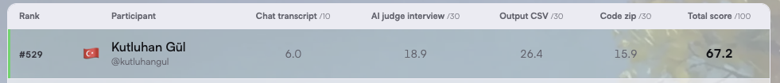
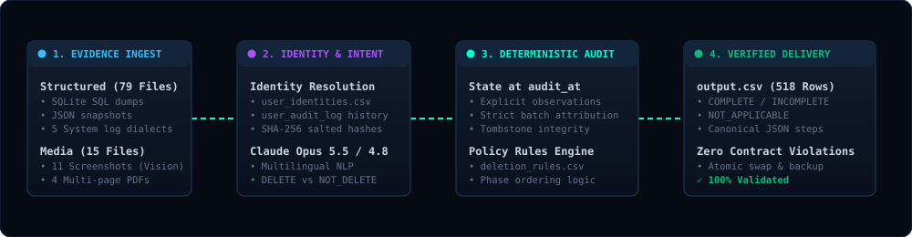

<div align="center">



<p>
  <a href="https://www.hackerrank.com/contests/hackerrank-orchestrate-october26/challenges/ghost-data-still-exists/leaderboard"></a>
  
  
  
</p>

<p><em>An autonomous data-deletion audit agent built for the "Ghost Data Still Exists" challenge.<br>
Deterministic parsing for everything structured, a language model only where pixels and natural language demand it.</em></p>



</div>


## The problem

A customer of a fictional e-commerce platform believes their account was deleted. Weeks later they try to sign up again and get *"This email is already registered."* Internal dashboards say the deletion request is **Complete**; underneath, personal data still lives on in backups, logs and side systems.

For **518 deletion requests**, the agent has to:

1. **Detect intent**: is this really a deletion request, and is it `COMPLETE`, `INCOMPLETE` or `NOT_APPLICABLE`?
2. **Resolve identity**: every current and past email, phone, username and SHA-256 email hash.
3. **Establish truth at `audit_at`**: reported statuses are claims; only concrete evidence counts.
4. **Write ordered steps**: a finding, a remediation and a verification for every piece of data left behind, following the deletion policy.


## The approach: deterministic core, LLM at the edges



| Principle | |
|---|---|
| **94 evidence files, split** | 79 structured files (SQL snapshots, JSON, five log dialects, handover notes) are parsed by plain Python: deterministic, zero tokens. |
| **LLM only where needed** | The model reads multilingual requests, 11 screenshots and 4 PDFs, and nothing else. Rules take over if it is unavailable. |
| **Claims are not evidence** | `reported_status = COMPLETE` is never taken as truth; only observation records decide. |
| **Time cut-off** | Nothing that happened after `audit_at` may justify a verdict. |
| **Reproducible** | Model answers are cached on disk with usage accounting, so `python3 code/main.py` reproduces the output without an API key. |

| Module | Job |
|---|---|
| `evidence.py` | Turn every evidence file into normalised observations |
| `identity.py` | Current snapshot + historical audit log → every identifier of a subject |
| `intent.py` | Does the request text authorise deletion? LLM first, rules as fallback |
| `media.py` | Screenshots and PDFs → observations, through the model's vision and document input |
| `batch.py` | Link workflow activity to cases when no evidence names the subject |
| `planner.py` | Per case: which resources belong to the subject, their state at `audit_at`, and the ordered steps |
| `llm.py` · `prompts.py` | A thin client with disk cache, usage accounting and offline fallback; versioned prompts |


## Measured results

Only the 32 public sample cases have labels, so accuracy is measured there; all 518 evaluation cases pass the output contract.

| Metric (32 labelled cases, final live run) | Value |
|---|---|
| Case-level status accuracy | 1.000 (32 / 32) |
| Exact case accuracy (status and every step, in order) | 0.750 (24 / 32) |
| Step precision · recall · F1 | 0.969 · 0.969 · 0.969 |
| Contract violations on the 518 submitted cases | 0 |
| Official score · global rank | 67.2 · #529 |

`code/evaluation/evaluation_report.md` has the full tables, the offline comparison run and how to reproduce every number.


## Türkçe özet

Bu proje, **HackerRank Orchestrate (Ekim 2026)** yarışmasındaki "Ghost Data Still Exists" görevi için geliştirdiğim otonom bir veri silme denetim ajanı; global sıralamada **#529** oldu. 518 silme talebi için kullanıcının gerçekten silinip silinmediğini kanıtlardan çıkarıyor ve eksik kalan her veri için bulgu, düzeltme ve doğrulama adımları yazıyor. 94 kanıt dosyasının 79'u saf Python ile, sıfır token harcanarak okunuyor; dil modeli yalnızca çok dilli talepler, 11 ekran görüntüsü ve 4 PDF için kullanılıyor. Etiketli 32 örnek vakada durum doğruluğu %100, adım F1 0,969; tam çalıştırma yaklaşık 0,60 dolar tutuyor.


## Running it

```sh
pip install -r code/requirements.txt
python3 code/main.py                         # reproduces output.csv from the cached model answers
python3 code/main.py --live                  # calls the model for anything not cached
python3 code/evaluation/validate_output.py   # output contract checks
python3 code/evaluation/main.py              # scoring against the sample set
```

```
code/main.py           CLI entry: atomic writes, cache checks
code/ghost_audit/      evidence, identity, intent, media, batch, planner, llm, prompts
code/evaluation/       metrics, contract validation, usage report
dataset/               the challenge data and evidence index
output.csv             the submitted answer · output.usage.json its token usage
```

<div align="center">
<br>
<a href="https://github.com/kutluhangil"></a>
<sub>HackerRank Orchestrate · October 2026 · score 67.2 · rank #529 · the case in the banner is illustrative.</sub>
</div>
